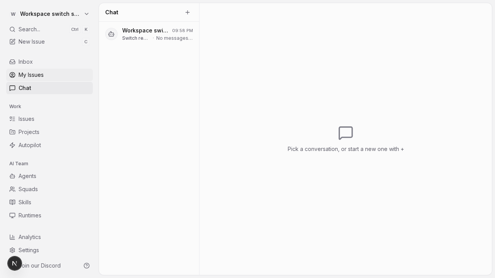
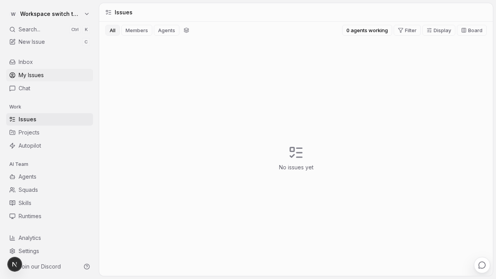

# Chat workspace switch regression evidence

These screenshots use a local checkout and disposable test fixtures. No messages or agent tasks are sent.

- **Before:** official `multica-ai/multica` main at `67d61a2073bad0fbb7140fd2000f1ab7ec0a4f25`. Opening an existing conversation and selecting another workspace returns to the source workspace's bare `/chat` route.
- **After:** `codex/fix-chat-workspace-switch`, based on that official commit. All 10 successive switches remain on the target workspace's `/issues` route.

## Reproduce locally

The companion script uses the repository's `TestApiClient` for authentication and cleanup, and the same database fixture approach as `e2e/chat-attachments.spec.ts`. Its runtime is a fake cloud runtime; it never invokes an installed agent CLI.

1. Set up the official checkout using `CONTRIBUTING.md`, then run `make up C=api,web`.
2. Copy `workspace-switch-repro.spec.ts` into that checkout's `e2e/` directory.
3. Run `SWITCH_REPRO_COUNT=10 SWITCH_REPRO_SCREENSHOT=/tmp/workspace-switch.png pnpm exec playwright test e2e/workspace-switch-repro.spec.ts` from its root. Run once on the original main for the failure and on the fix branch for the passing result.
4. Remove the temporary script after use. This evidence branch is separate from the implementation PR.

The committed regression tests in the fix also check a real chat store and controller through workspace rehydration, including preservation of the target workspace's persisted session and project selection.
