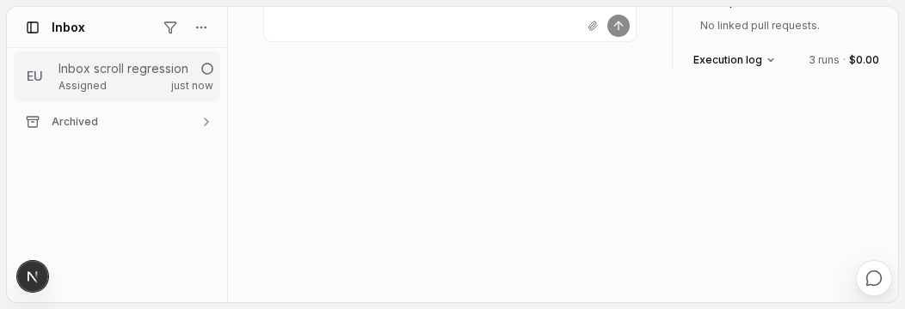
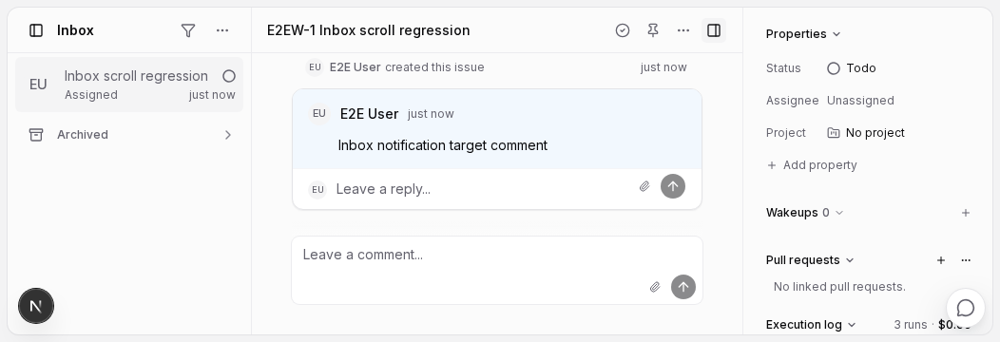

# Inbox detail scrolling: before and after

Upstream baseline: `47120a4131564175da044d63d897ed9b5d76979a`  
Fix candidate: `f8f42dd2b2858ee1e3dea52da4091f292f8f6fd0`

The same Chromium regression at 1052×360 fails on unmodified current main and passes after the fix.

| Measurement | Before | After |
| --- | ---: | ---: |
| Outer detail scrollTop | 272px | 0px |
| Detail column top | −264px | 8px |
| Header | Scrolled out of view | Remains visible |

## Before

## After

## Validation

- Four browser regression cases passed on the candidate.
- The focused 1052px case failed before and passed after.
- 65 targeted component tests passed in two files.
- Views typecheck, targeted ESLint and diff checks passed.
- [Measurements and verification limits](measurements.json).

The screenshots contain synthetic local test data. Browser coverage used Linux Chromium; macOS Chrome 155 and Electron were not run.
