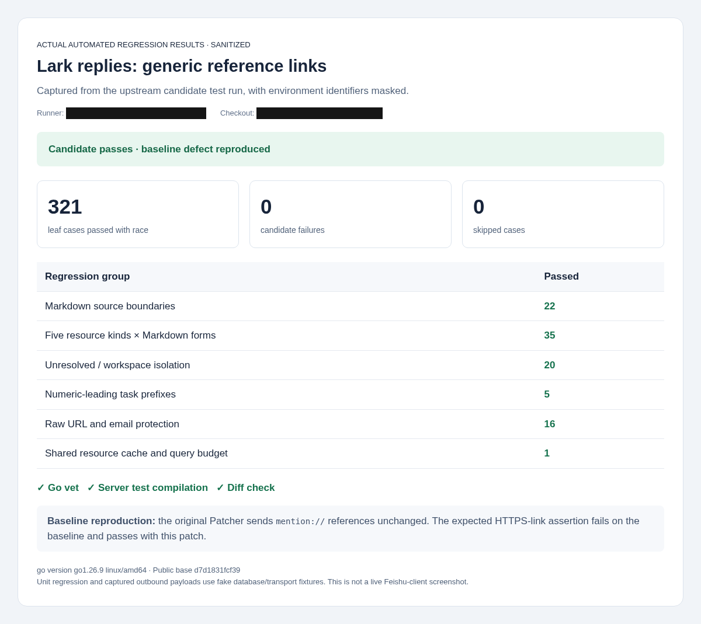
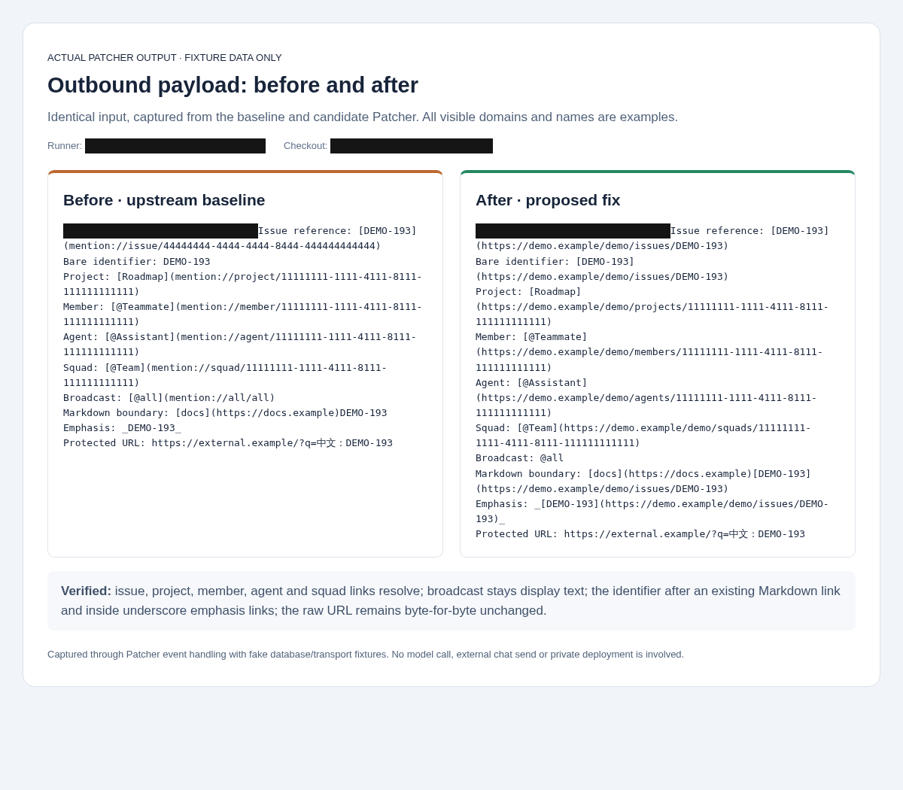

# Lark reference-link regression evidence

Candidate: https://github.com/Frezc/multica/commit/7ef49f2d1b5dc6486a3acda2b36c96b7af40571b

Public base: d7d1831fcf39b874911aae1e48b2fbf804bd068e. The published code tree is byte-identical to the locally tested tree.

321 selected leaf cases pass with race, 0 failed, 0 skipped, using Go 1.26.9. Go vet for channel/lark/server and server test-program compilation pass. The original Patcher was separately exercised with the same input and captured its unconverted output; the expected HTTPS-link assertion fails on that baseline and passes on the candidate.

## Screenshots





These are browser captures of actual Go regression results and captured Patcher output, using synthetic database and transport fixtures. They are not screenshots of a live Feishu client. Runner, local checkout and recipient identifiers are covered during screenshot capture. All other visible names, UUIDs and domains are examples. The PNGs contain no EXIF or embedded text metadata. No original private screenshot is included.

## Reproduce the selected suite

On the candidate checkout, download focused-pattern.txt from this evidence directory, then run from server/:

```sh
go test -race ./internal/integrations/channel ./internal/integrations/lark -run "$(cat /path/to/focused-pattern.txt)" -count=1 -json
go vet ./internal/integrations/channel ./internal/integrations/lark ./cmd/server
go test ./cmd/server -run '^$' -count=1
```

The filter includes parsing, reference resolution, reply routing and related outbound HTTP regression cases. Full database/Redis suites, frontend suites and live Feishu/model round trips were not run for this patch. Captured-outbound.json preserves the fixture input and actual output for both revisions.
