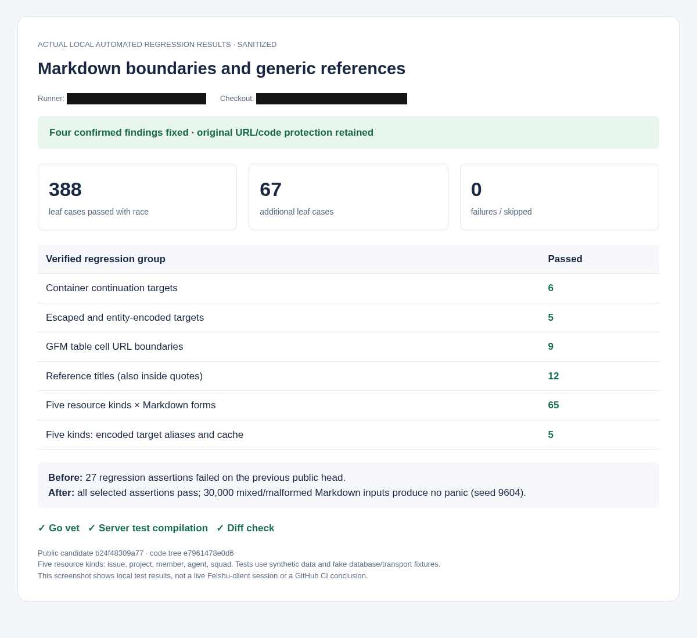

# Markdown reference self-review evidence

Reviewed public source: https://github.com/Frezc/multica/commit/b24f48309a7716df5850eab0912a510fd60e096c

The source tree matches the locally tested tree. This follow-up fixes three missed-link cases and one title-preservation issue:

- Link destinations continued on blockquote/list container lines use the parser's source positions.
- Backslash-escaped and HTML-entity reference destinations normalize consistently with Markdown rendering.
- Raw URL protection stops at real GFM table cell boundaries, while escaped pipes and non-table URLs remain intact.
- Expanding reference-style links preserves rendered titles, including escaping and container continuations.

27 regression assertions fail on the preceding public head. The final selected suite passes 388 leaf cases with race (67 additional cases, 0 failed/skipped). Five resource kinds and normalized-target cache behavior are covered. Go vet and server test-program compilation pass. An additional 30,000 mixed/malformed Markdown-input probe completes without a panic (seed 9604).



The screenshot is a browser capture of actual local regression results. Runner and checkout identifiers are covered during capture. It contains no EXIF or embedded text metadata and shows no live Feishu-client session or GitHub CI result. All tests use synthetic data; the existing outbound-payload screenshot is retained separately.

## Reproduce

Download focused-pattern.txt, then run from the reviewed source's server directory:

```sh
go test -race ./internal/integrations/channel ./internal/integrations/lark -run "$(cat /path/to/focused-pattern.txt)" -count=1 -json
go vet ./internal/integrations/channel ./internal/integrations/lark ./cmd/server
go test ./cmd/server -run '^$' -count=1
```

The full upstream CI result is reported in the pull request. Local database/Redis integration, frontend suites, and live Feishu/model round trips were not run for this follow-up.
